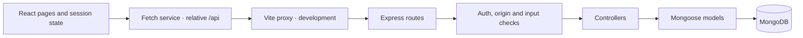

# BizLeap Lead Management System

BizLeap is a Mini CRM for tracking prospective customers from first contact through conversion. One administrator can manage lead records, find prospects that need attention and see how the pipeline and acquisition sources are performing.

## Features

- Administrator sign-in, sign-out and protected dashboard and lead pages.
- Add, view, edit and delete leads. Change a lead’s status directly from the list.
- Search by name, email, phone or company. Filter by status and source, with server-side pagination.
- Dashboard counts for total, new, contacted and converted leads, plus the status breakdown, 30-day activity and acquisition sources.
- Responsive lead tables and mobile cards, keyboard-operable controls, and loading, empty and error states.
- Input validation and field-level feedback. Edit and inline status changes check for a newer record before saving.

## Technology stack

| Layer | Technologies | Role |
| --- | --- | --- |
| Frontend | React 19, React Router 7, Vite 8 | Component-based UI, client routing and a development proxy for the API |
| Design and charts | Tailwind CSS 3, Recharts 3 | Shared responsive styles, self-hosted fonts, icons and dashboard charts |
| API | Node.js, Express 5 | REST routing, authentication and validation middleware, and consistent JSON responses |
| Persistence | MongoDB, Mongoose 9 | Validated models, indexed lead ordering and database-side dashboard aggregation |
| Security and testing | bcryptjs, jsonwebtoken, Helmet, express-rate-limit, Node.js test runner, ESLint | Password hashing, signed sessions, HTTP protections, regression tests and linting |

## Prerequisites

- Node.js 24 LTS recommended. The API declares Node.js `^20.19.0 || >=22.12.0`. For the full workflow including ESLint, use Node.js 20.19+ in the 20.x series, 22.13+ in the 22.x series, or 24+. Verified with Node.js 24.18.1 and npm 11.16.0. Use the npm bundled with the recommended Node.js version. The project does not declare a separate npm engine range.
- A running MongoDB instance accessible to the API. The setup below uses `127.0.0.1:27017` and was verified with MongoDB 8.3.4. The API also accepts `mongodb+srv://` connection strings.
- Git and a terminal. The examples use Windows PowerShell. On a shell without the Windows script shim, use `npm` in place of `npm.cmd`.

## Local Installation

### 1. Prerequisites

Make sure you have Node.js, npm, Git and MongoDB installed on your machine.

### 2. Clone the repository

```bash
git clone https://github.com/sarthakdubey1708/lead-management-system.git
cd lead-management-system
```

### 3. Backend setup

```bash
cd server
npm install
```

Create a `.env` file inside the `server` directory using `.env.example` as a reference.

Configure the following environment variables:

```env
PORT=5000
MONGODB_URI=mongodb://127.0.0.1:27017/lead_management
APP_ORIGIN=http://localhost:5173
JWT_SECRET=your_generated_secret
ADMIN_NAME=Admin
ADMIN_EMAIL=admin@example.com
ADMIN_PASSWORD=your_secure_password
```

Generate a secure JWT secret using:

```bash
node -e "console.log(require('node:crypto').randomBytes(32).toString('hex'))"
```

Replace `JWT_SECRET` with the generated value and choose your own administrator credentials. The password must contain at least 12 characters and no more than 72 UTF-8 bytes.

With MongoDB running, seed the administrator account and 40 fictional sample leads:

```bash
npm run seed
```

Start the backend:

```bash
npm run dev
```

The backend runs at `http://localhost:5000`.

### 4. Frontend setup

Open a new terminal from the project root:

```bash
cd client
npm install
npm run dev
```

### 5. Open the application

Visit [http://localhost:5173](http://localhost:5173).

Log in using the administrator email and password configured during database seeding.

**Note:** Windows PowerShell users can use `npm.cmd` instead of `npm` if script execution is restricted. Never commit your `.env` file or actual credentials.

## Environment variables

`server/.env.example` contains local defaults and placeholders. Server configuration may also be supplied through process environment variables.

| Variable | Required | Purpose |
| --- | --- | --- |
| `MONGODB_URI` | API, seed and date refresh | MongoDB connection string with `mongodb://` or `mongodb+srv://` scheme |
| `JWT_SECRET` | API and seed | Random 64-character hex signing key |
| `PORT` | Optional | Loopback API port, defaults to `5000` |
| `NODE_ENV` | Optional | `development` by default. Set `production` for production proxy behavior |
| `APP_ORIGIN` | Required in production | Exact browser origin with no trailing slash. Defaults to `http://localhost:5173` in development. Production requires HTTPS |
| `LOGIN_RATE_LIMIT` | Optional | Maximum login requests per IP per 15-minute window, defaults to `10` |
| `ADMIN_NAME` | Seed only | Display name of the initial administrator |
| `ADMIN_EMAIL` | Seed only | Email address used to sign in |
| `ADMIN_PASSWORD` | Seed only | Private password for the initial administrator |
| `MONGODB_TEST_URI` | Optional, backend tests only | Set in the test process environment to override `mongodb://127.0.0.1:27017` |

The retained `client/.env.example` documents `/api` as `VITE_API_BASE_URL`. The application uses `/api` directly, so changing that variable has no effect. Vite environment variables are public.

## Sample dataset

On an empty database, the seed creates 40 fictional leads with these statuses. Creation dates follow a fixed, uneven schedule anchored to the UTC seed date.

| New | Contacted | Interested | Converted | Lost |
| ---: | ---: | ---: | ---: | ---: |
| 12 | 10 | 8 | 6 | 4 |

The seed inserts missing fixture IDs and preserves edits on existing records. It keeps the existing administrator, so changing seed credentials later does not rotate that account. Dashboard figures and charts come from MongoDB. The activity chart includes zero-count days in its 30-day UTC window.

To move existing sample dates into the current reporting window, start with a preview in `server`.

```powershell
$sampleDate = [DateTime]::UtcNow.ToString('yyyy-MM-dd')
node .\seeds\refresh-sample-dates.js --date $sampleDate
```

Check the database name and planned record count. When they match the intended update, apply and verify using the same UTC date.

```powershell
node .\seeds\refresh-sample-dates.js --date $sampleDate --apply
node .\seeds\refresh-sample-dates.js --date $sampleDate
```

The refresh targets existing records with the original fixture IDs and changes only `createdAt`. It skips missing IDs and preserves all other fields, including `updatedAt`. The last preview should report zero planned changes.

## API overview

| Method | Endpoint | Purpose | Admin session |
| --- | --- | --- | --- |
| `POST` | `/api/auth/login` | Verify credentials and set the session cookie | No |
| `GET` | `/api/auth/me` | Read the current administrator | Yes |
| `POST` | `/api/auth/logout` | Clear the session cookie | No |
| `GET` | `/api/leads` | Search, filter and paginate leads | Yes |
| `POST` | `/api/leads` | Create a lead | Yes |
| `GET` | `/api/leads/:id` | Read one lead | Yes |
| `PUT` | `/api/leads/:id` | Replace the six writable fields, including status | Yes |
| `DELETE` | `/api/leads/:id` | Delete a lead | Yes |
| `GET` | `/api/dashboard/summary` | Read status totals, source counts and 30 daily counts | Yes |

See the [API contract](docs/api-contract.md) for request and response shapes, validation rules and error codes.

## Architecture



- **Session lifecycle.** React checks `/api/auth/me` on startup before rendering protected routes. Express verifies the cookie and the current administrator role. A protected request that returns `401` clears the frontend session.
- **Lead lifecycle.** The client calls Express with same-origin requests. Routes apply the relevant checks before controllers query or mutate MongoDB. Successful mutations refresh the lead list and dashboard summary. The `leads` collection stores name, email, phone, company, source, status and timestamps. The `users` collection stores the administrator with a password hash. All leads are shared within the single administrator workspace and have no owner reference.
- **Dashboard and errors.** A MongoDB aggregation computes pipeline and acquisition counts and groups recent leads by UTC creation day. The controller fills missing days with zero. API errors follow a shared JSON format, which the UI uses to show field errors or request feedback.

See the [design system](DESIGN.md) for UI tokens, breakpoints and keyboard behavior.

## Authentication and security

Administrator passwords are hashed with bcryptjs at cost 12. A successful login issues an HS256 JWT that expires after eight hours. The browser stores it in an HTTP-only, `SameSite=Strict` cookie scoped to `/api`. The cookie uses `Secure` when the origin uses HTTPS. Protected endpoints verify the signature, expiry and current administrator role.

Express rate-limits login by IP, checks the exact configured `Origin` for write requests, and falls back to an exact-origin `Referer` when `Origin` is absent. It validates request bodies, IDs and query parameters and applies Helmet security headers. Credentials and signing keys are supplied through the server environment.

## Testing

Run the frontend checks from `client`.

```powershell
npm.cmd run lint
node --test test/update-current-lead.test.js
npm.cmd run build
```

Run the backend checks from `server` with MongoDB running.

```powershell
npm.cmd run lint
npm.cmd test
```

The frontend regression suite covers a lead edited after the list was loaded, retry behavior and failed detail requests. The backend suite creates a randomly named MongoDB database and a disposable administrator, then drops that test database. Its connection needs permission to create and drop the test database. For a different test server, set `$env:MONGODB_TEST_URI` in the terminal before running the suite.

## Screenshots

Captured in the running application using fictional leads and a disposable demonstration administrator.


| Desktop (1440 px) | Mobile (390 px) |
| --- | --- |
| [Login](docs/screenshots/desktop-login.png) | [Dashboard](docs/screenshots/mobile-dashboard.png) |
| [Leads table](docs/screenshots/desktop-leads.png) | [Lead cards](docs/screenshots/mobile-leads.png) |
| [Add Lead dialog](docs/screenshots/add-lead-dialog.png) | |

## Scope and limitations

- The app supports one administrator. It has no public registration or per-lead ownership.
- Logout clears the current browser’s cookie. A copied token can remain valid until its eight-hour expiration while the signing key and administrator role are unchanged.
- Stale edits are detected by comparing the record displayed in the UI with a fresh detail response before sending the full `PUT`. An update arriving between that check and the write can still race.
- Local development uses Vite and the loopback API. A production deployment needs an HTTPS reverse proxy on the API host to serve `client/dist`, handle client route fallback and route `/api` to Express. Set `NODE_ENV=production`, configure the exact public `APP_ORIGIN`, and have the proxy replace incoming forwarded client IP, host and protocol headers with trusted values. This repository documents local setup.
