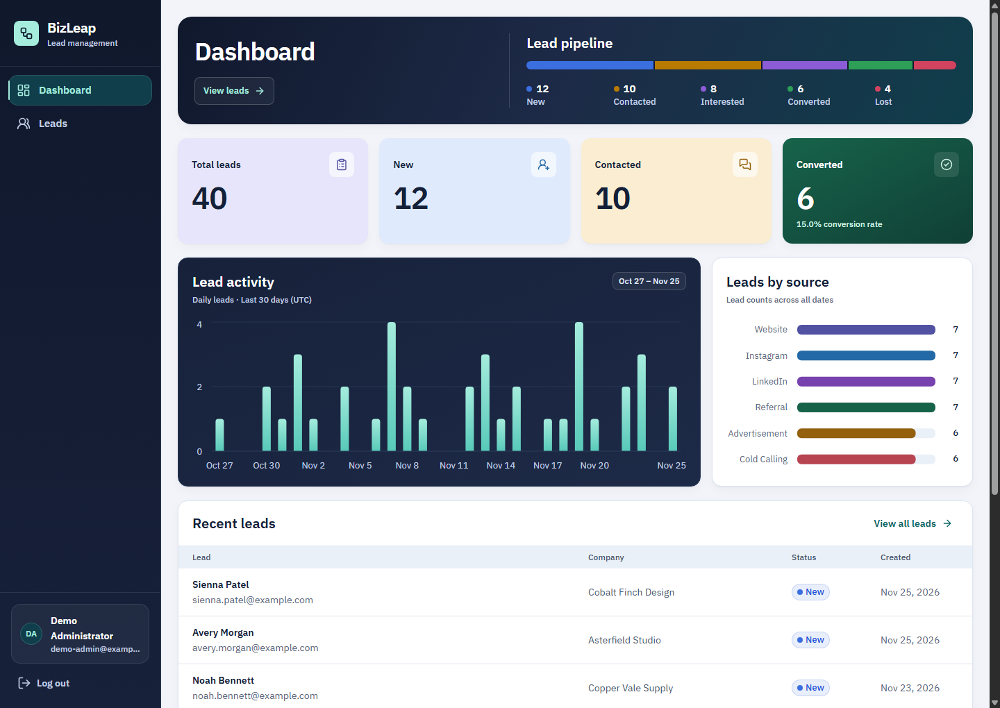
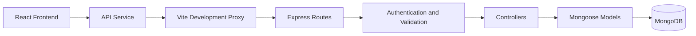

# BizLeap Lead Management System

A responsive full-stack Mini CRM for managing potential customers, tracking lead status and monitoring sales pipeline performance. Built using React, Node.js, Express and MongoDB.

[Open the live demo](https://bizleap-crm.vercel.app). Administrator sign-in is required.

## Screenshots



| Desktop | Mobile |
| --- | --- |
| [Login Page](docs/screenshots/desktop-login.png) | [Dashboard](docs/screenshots/mobile-dashboard.png) |
| [Leads Management](docs/screenshots/desktop-leads.png) | [Lead Cards](docs/screenshots/mobile-leads.png) |
| [Add Lead Dialog](docs/screenshots/add-lead-dialog.png) | |

## Features

- Administrator login, logout and protected routes.
- Create, view, edit and delete leads.
- Inline lead status updates.
- Search by name, email, phone or company.
- Status and source filters with server-side pagination.
- Dashboard statistics, lead activity and source distribution charts.
- Responsive desktop and mobile layouts.
- Input validation, error handling and stale-data conflict detection.

## Technology Stack

| Layer | Technologies |
| --- | --- |
| Frontend | React, Vite, React Router |
| Styling | Tailwind CSS, Lucide React |
| Data Visualization | Recharts |
| Backend | Node.js, Express.js |
| Database | MongoDB, Mongoose |
| Authentication | JWT, bcryptjs |
| Security | Helmet, express-rate-limit |
| Testing | Node.js Test Runner, ESLint |
| Version Control | Git, GitHub |

## Getting Started

### Prerequisites

- Node.js 24 LTS (recommended)
- npm
- MongoDB
- Git

### 1. Clone the repository

```bash
git clone https://github.com/sarthakdubey1708/lead-management-system.git
cd lead-management-system
```

### 2. Backend setup

```bash
cd server
npm ci
```

Create a `server/.env` file using `.env.example` as a reference.

```env
PORT=5000
MONGODB_URI=mongodb://127.0.0.1:27017/lead_management
APP_ORIGIN=http://localhost:5173
JWT_SECRET=your_generated_secret
ADMIN_NAME=Admin
ADMIN_EMAIL=admin@example.com
ADMIN_PASSWORD=your_secure_password
```

Generate a secure JWT secret:

```bash
node -e "console.log(require('node:crypto').randomBytes(32).toString('hex'))"
```

Use the generated value for `JWT_SECRET` and choose your own administrator credentials. The password must contain at least 12 characters and no more than 72 UTF-8 bytes.

With MongoDB running, seed the database and start the backend:

```bash
npm run seed
npm run dev
```

### 3. Frontend setup

Open a second terminal from the project root:

```bash
cd client
npm ci
npm run dev
```

### 4. Access the application

Open [http://localhost:5173](http://localhost:5173) and sign in using the administrator credentials configured during database seeding.

**Note:** Windows PowerShell users can use `npm.cmd` instead of `npm` if script execution is restricted. Never commit actual `.env` files or credentials.


## Vercel Deployment

Use the repository root, the Other preset and Node.js 24.x. The settings in `vercel.json` install both packages, build the Vite frontend and route `/api` to the Express function in Mumbai (`bom1`). The UI and API share an HTTPS origin.

Set `APP_ORIGIN` to the exact production HTTPS origin, `MONGODB_URI` to the Atlas URI for `lead_management`, and `JWT_SECRET` to a random 64-character hex key in Vercel's Production environment. The Atlas IP access list must permit Vercel's outbound connections.

The API uses secure session cookies and exact-origin checks for writes. The Express login limiter applies per function instance. The live demo also limits login requests to 10 per IP per minute in each Vercel firewall region.

## System Architecture



The application follows a layered client-server architecture. React handles the user interface and sends REST API requests to Express. Middleware handles authentication and validation, while controllers manage business logic and interact with MongoDB through Mongoose.

Dashboard statistics are calculated using MongoDB aggregation rather than hardcoded frontend values.

## Project Structure

```text
lead-management-system/
├── client/
│   ├── public/
│   ├── src/
│   │   ├── api/
│   │   ├── auth/
│   │   ├── components/
│   │   ├── dashboard/
│   │   ├── leads/
│   │   └── utils/
│   └── test/
├── server/
│   ├── config/
│   ├── constants/
│   ├── controllers/
│   ├── middleware/
│   ├── models/
│   ├── routes/
│   ├── seeds/
│   ├── test/
│   ├── utils/
│   └── validators/
├── docs/
├── DESIGN.md
└── README.md
```

## API Endpoints

| Method | Endpoint | Description |
| --- | --- | --- |
| POST | `/api/auth/login` | Administrator login |
| GET | `/api/auth/me` | Verify current session |
| POST | `/api/auth/logout` | Administrator logout |
| GET | `/api/leads` | Retrieve, search and filter leads |
| POST | `/api/leads` | Create a lead |
| GET | `/api/leads/:id` | Retrieve a specific lead |
| PUT | `/api/leads/:id` | Update lead details and status |
| DELETE | `/api/leads/:id` | Delete a lead |
| GET | `/api/dashboard/summary` | Retrieve dashboard statistics |

All lead and dashboard endpoints require an authenticated administrator session.

See the [API Documentation](docs/api-contract.md) for detailed request and response formats.

## Sample Dataset

The seed script creates 40 fictional leads on an empty database.

| New | Contacted | Interested | Converted | Lost |
| ---: | ---: | ---: | ---: | ---: |
| 12 | 10 | 8 | 6 | 4 |

Lead creation dates are distributed unevenly across 30 UTC days. Seeding is idempotent and preserves existing records and administrator credentials.

The optional `server/seeds/refresh-sample-dates.js` utility can refresh the original sample leads' creation dates. It defaults to preview mode and requires `--apply` to perform changes.

## Authentication and Security

- Password hashing using bcryptjs with cost factor 12.
- JWT authentication with eight-hour session expiration.
- HTTP-only, SameSite Strict cookies with Secure enabled for HTTPS.
- Protected API endpoints and administrator role verification.
- Login rate limiting and request origin validation.
- Server-side input validation and Helmet security headers.
- Environment-based credential and secret management.

## Testing

The project has passed 26 backend tests and 3 frontend regression tests, along with lint and production build checks.

**Frontend — from `client/`:**

```bash
npm run lint
node --test test/update-current-lead.test.js
npm run build
```

**Backend — from `server/`, with MongoDB running:**

```bash
npm run lint
npm test
```

Backend tests use an isolated temporary database to avoid modifying existing application data.

## Limitations

- Designed for a single administrator.
- Logout clears the browser cookie; JWTs expire independently.
- Stale-data conflict checks reduce accidental overwrites but do not provide atomic concurrency protection.
- Public deployment requires HTTPS and a properly configured reverse proxy.

## Additional Documentation

- [API Contract](docs/api-contract.md)
- [Design System](DESIGN.md)
